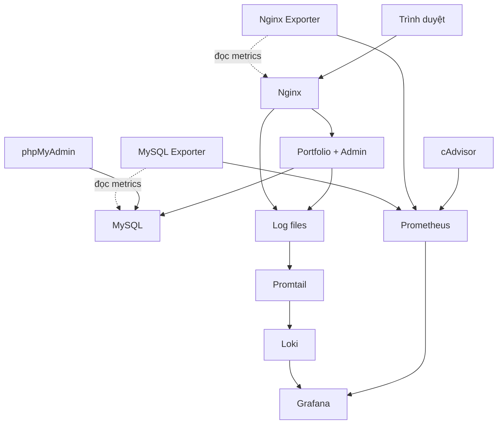

# Hướng dẫn Đề 13 từ A đến Z

## 1. Chốt đề và mục tiêu

Tên đăng ký giữ đúng danh sách: **Đề 13 - Website Portfolio / Giới thiệu Cá nhân**.

Tên trên bìa: **Triển khai và quản trị website Portfolio cá nhân an toàn bằng Docker Compose, tích hợp giám sát và log tập trung**.

Theo PDF `De_Tai_Thuc_Hanh - TKQT HTPM K23.pdf`, ứng dụng phải có admin quản lý nội dung, dùng MySQL và phpMyAdmin. Tất cả dịch vụ triển khai bằng Docker Compose. Có GitHub và README, Nginx, Prometheus + Grafana giám sát container/web/DB, Loki + Promtail và ít nhất 2-3 LogQL query, hardening, báo cáo tối thiểu 10 trang có hình minh họa.

| Tiêu chí | Điểm | Kết quả cần đạt |
|---|---:|---|
| GitHub | 1,5 | Source, cấu hình, README, tối thiểu 3 commit có ý nghĩa |
| App + DB | 1,5 | Website, admin, DB và phpMyAdmin hoạt động |
| Nginx | 1,5 | Truy cập qua proxy, có security headers hoặc HTTPS |
| Monitoring | 1,5 | Metrics thật của container/web/database |
| Logging | 1,5 | Log tập trung, 2-3 query trả kết quả |
| Hardening | 1,5 | Ít nhất 3-4 biện pháp có minh chứng |
| Tổng thể | 1,0 | Compose, demo, screenshot và hiểu hệ thống |

Đây là bộ triển khai mẫu để bạn học, sửa và kiểm chứng. Những dự án có sẵn trên portfolio là dữ liệu mẫu, không phải thành tích thực tế. Báo cáo cần sử dụng kết quả từ máy bạn; không viết hệ thống đã chạy nếu chưa thử.

## 2. Chuẩn bị máy

Hướng dẫn lấy **Windows + Ubuntu WSL2 + Docker Desktop Linux containers** làm đường đi chính. Nếu bạn đã dùng Ubuntu Linux với Docker Engine và Compose v2 thì bỏ bước Windows/WSL. Bạn không cần thuê VPS vì PDF không bắt buộc công khai website.

1. Mở PowerShell với quyền quản trị nếu chưa có WSL, chạy:

```powershell
wsl --install -d Ubuntu
```

2. Khởi động lại nếu Windows yêu cầu. Mở Ubuntu, tạo username và password Linux.
3. Cài Docker Desktop từ https://docs.docker.com/desktop/setup/install/windows-install/ và dùng WSL2 backend.
4. Docker Desktop > Settings > Resources > WSL Integration: bật distro Ubuntu bạn sử dụng. Đảm bảo dùng Linux containers.
5. Mở terminal **Ubuntu**, kiểm tra:

```bash
docker version
docker compose version
git --version
python3 --version
```

`docker version` phải có phần Server, không chỉ Client. Nếu thiếu, mở Docker Desktop và kiểm tra WSL Integration. Dùng `docker compose`, không dùng lệnh cũ `docker-compose`.

Nếu Ubuntu thiếu Git/Python/unzip:

```bash
sudo apt update
sudo apt install -y git python3 unzip openssl
```

Nên làm dự án trong thư mục Linux `~/projects` thay vì trực tiếp trong ổ Windows. Mức tài nguyên gợi ý cho toàn stack là 4 CPU và 6-8 GB RAM; đây là ước lượng, không phải yêu cầu chính thức. Nếu RAM ít, hoàn thành giai đoạn 1 trước rồi bật từng phần.

**cAdvisor phụ thuộc host:** cấu hình được viết theo Docker trên Linux. Docker Desktop có lớp máy ảo, nên cần kiểm tra metrics thực tế. Nếu lỗi `/dev/kmsg` hoặc không thấy container labels, xem mục xử lý lỗi. Nếu không thu đủ metrics, dùng Ubuntu Linux/Docker Engine trên máy hoặc VM hỗ trợ virtualization; không bỏ panel container rồi tuyên bố hoàn thành.

## 3. Giải nén và hiểu bộ file

Giải nén `De13_Portfolio_A_Z.zip`, vào thư mục `de13-portfolio` chứa `compose.yaml`. Có thể giải nén bằng Windows rồi copy thư mục vào Ubuntu. Ví dụ trong Ubuntu:

```bash
mkdir -p ~/projects
```

Copy thư mục đã giải nén vào `~/projects/de13-portfolio` bằng File Explorer tại đường dẫn WSL, hoặc lệnh `cp -r` với đường dẫn thực tế của bạn. Sau đó:

```bash
cd ~/projects/de13-portfolio
ls
```

Không cần tạo từng file theo hướng dẫn: source và cấu hình đã có. Tuy vậy, bạn cần đọc và hiểu:

| File/thư mục | Nội dung cần hiểu |
|---|---|
| `app/src/app.js` | Route, session, CSRF, kiểm tra admin, CRUD, log |
| `app/src/repository.js` | SQL tham số hóa và session MySQL |
| `app/src/security.js` | Băm mật khẩu scrypt, validation |
| `app/views` | EJS render và escape dữ liệu |
| `db/init/01-schema.sh` | Bảng, seed và tạo DB users |
| `app/Dockerfile` | Build app và USER node |
| `compose.yaml` | App + DB + DB tool + reverse proxy |
| `compose.monitoring.yaml` | cAdvisor, exporters, Prometheus, Grafana |
| `compose.logging.yaml` | Loki, Promtail, datasource |
| `nginx/` | Reverse proxy, log JSON, headers, HTTPS tùy chọn |
| `monitoring/` | Scrape targets, dashboard và alert rules |
| `logging/` | Luồng log, positions và cấu hình Loki |
| `scripts/` | Setup, Compose wrapper, traffic, smoke, backup/restore |

## 4. Kiến trúc để đưa vào báo cáo



Giải thích: trình duyệt chỉ vào Nginx; Nginx proxy request tới app; app dùng tên service `mysql` để kết nối DB. Prometheus chủ động scrape endpoint exporters; mũi tên trong sơ đồ biểu diễn hướng dữ liệu metrics. Grafana đọc dữ liệu từ Prometheus/Loki để hiển thị. Promtail đọc file log, push tới Loki.

Mạng `web` có Nginx/app/nginx-exporter, mạng `database` có MySQL/app/phpMyAdmin/mysql-exporter và được đặt `internal: true`. Nginx không nằm trong mạng database. MySQL và app không publish cổng host. Công cụ quản trị chỉ bind `127.0.0.1`. Đây là isolation ở mức mạng Compose, không phải hệ thống firewall chặn từng route trong ứng dụng.

cAdvisor là collector có quyền host cao. Mount Docker socket với `:ro` không biến Docker API thành API chỉ đọc; không coi đó là biện pháp hạn chế quyền API. Ghi rõ ngoại lệ này trong báo cáo.

App có 5 bảng: `users`, `profiles`, `projects`, `skills`, `sessions`. Một tài khoản admin quản lý toàn bộ nội dung, chưa có RBAC nhiều vai trò. Session lưu DB, không dùng MemoryStore khi triển khai.

## 5. Tạo mật khẩu và cấu hình

Ở thư mục gốc:

```bash
python3 scripts/setup.py
chmod +x db/init/01-schema.sh
```

Lệnh sinh `.env` với mật khẩu ngẫu nhiên và `secrets/exporter.cnf` chứa tài khoản giám sát. Script không in mật khẩu ra terminal và từ chối ghi đè file đang tồn tại.

Mở `.env` bằng editor cá nhân, ghi nhớ vị trí các giá trị:

| Giá trị | Dùng ở đâu |
|---|---|
| `ADMIN_USERNAME`, `ADMIN_INITIAL_PASSWORD` | Đăng nhập website |
| `APP_DB_PASSWORD` | App và đăng nhập phpMyAdmin với user `portfolio_app` |
| `GRAFANA_ADMIN_PASSWORD` | Grafana với user `admin` |
| `MYSQL_ROOT_PASSWORD` | Quản trị DB bên trong container |
| `MYSQL_MONITOR_PASSWORD` | Exporter, không dùng cho app |
| `SESSION_SECRET` | Ký cookie session |

Không chụp màn hình `.env`. `.gitignore` đã loại `.env`, secrets, certs, backup và node_modules. Phần SQL init chỉ chấp nhận DB passwords dạng hex do script sinh, nhằm tránh lỗi escaping khi khởi tạo user.

**Sau khi MySQL đã có volume, sửa `.env` không tự đổi mật khẩu trong DB.** Giữ file cấu hình tương ứng với volume; nếu muốn đổi cần cập nhật DB user và cấu hình đồng bộ. Mật khẩu website chỉ seed lần đầu; thay `ADMIN_INITIAL_PASSWORD` sau đó không reset admin. Dùng form đổi mật khẩu trong admin.

## 6. Giai đoạn 1: Website, DB, phpMyAdmin và Nginx

```bash
python3 scripts/compose.py 1 config --quiet
python3 scripts/compose.py 1 up -d --build
python3 scripts/compose.py 1 ps -a
```

Lần đầu cần Internet để pull image và cài npm dependencies trong Docker build. `init-logs` kết thúc `Exited (0)` là bình thường: nó chỉ chuẩn bị quyền volume. MySQL/app cần healthy; Nginx/phpMyAdmin chạy. Kiểm tra log nếu chưa sẵn sàng:

```bash
python3 scripts/compose.py 1 logs --tail=80 mysql app nginx
```

Healthcheck MySQL xác nhận bảng seed đã tồn tại; app chỉ start sau `service_healthy`. `depends_on` đơn thuần không chứng minh database sẵn sàng.

| URL | Mục đích |
|---|---|
| http://localhost:8080 | Portfolio công khai qua Nginx |
| http://localhost:8080/login | Đăng nhập admin |
| http://localhost:8080/admin | Quản trị sau đăng nhập |
| http://localhost:8080/health | Kiểm tra app kết nối DB |
| http://localhost:8081 | phpMyAdmin |

Nếu đổi `WEB_PORT`/`PMA_PORT` trong `.env`, dùng port tương ứng. Vào phpMyAdmin bằng user `portfolio_app`, password `APP_DB_PASSWORD`, không dùng tài khoản website. User DB của app không có quyền tạo bảng hay quản lý users; schema được khởi tạo bằng DB root bên trong container.

Thực hiện lần lượt:

1. Mở trang công khai, chụp ảnh tổng quan.
2. Đăng nhập admin, sửa họ tên, email và bio thành thông tin thật.
3. Thêm dự án thật của bạn, sửa dự án và kiểm tra trang công khai.
4. Xóa một dự án thử. Không xóa hết dữ liệu trước khi demo.
5. Thêm/xóa kỹ năng. Hiện chức năng kỹ năng chưa có form edit; có thể xóa và thêm lại.
6. Mở phpMyAdmin > `portfolio` > `projects` để chứng minh dữ liệu vừa sửa đã lưu.
7. Kiểm tra headers và health:

```bash
curl -I http://localhost:8080
curl http://localhost:8080/health
python3 scripts/smoke.py
```

Smoke kiểm tra trang công khai, health, headers, 404, chặn admin khi chưa đăng nhập, CSRF và đăng nhập admin. Nếu bạn đã đổi mật khẩu website, smoke dùng mật khẩu khởi tạo sẽ thất bại: kiểm tra đăng nhập bằng trình duyệt hoặc cập nhật cách cung cấp mật khẩu cho script, không reset DB.

Minh chứng: `01-compose-stage1.png`, `02-portfolio.png`, `03-admin.png`, `04-phpmyadmin.png`, `05-nginx-headers.png` trong `docs/evidence/`. Ảnh lấy từ máy bạn, không có mật khẩu/cookie.

### GitHub và commit 1

Tạo tài khoản/tên theo yêu cầu MSSV trong PDF. Nếu đã có tài khoản, xác nhận cách đặt tên giảng viên chấp nhận. Tạo repo ví dụ `MSSV-de13-portfolio`, không cần init README trên GitHub vì đã có README local.

```bash
git init
git branch -M main
git config user.name "HO TEN CUA BAN"
git config user.email "EMAIL_GITHUB_CUA_BAN"
git add app db nginx/nginx.conf nginx/site.conf compose.yaml .env.example .gitignore .gitattributes README.md scripts docs
git status --short
git diff --cached --stat
```

Kiểm tra `.env`, `secrets/`, `backups/`, `certs/`, `node_modules/` không nằm trong staged files. Lệnh add trên chủ ý chưa đưa `monitoring/`, `logging/` và Compose override giai đoạn sau vào commit 1. Thêm chúng khi bạn triển khai và xác nhận từng giai đoạn, để commit 2/3 có cấu hình và minh chứng thực tế. Không tạo commit rỗng.

```bash
git commit -m "feat: deploy portfolio mysql phpmyadmin and nginx proxy"
```

Thêm remote bằng URL HTTPS thực của repo:

```bash
git remote add origin https://github.com/TAI_KHOAN_GITHUB/MSSV-de13-portfolio.git
git push -u origin main
```

Thay `TAI_KHOAN_GITHUB`, `MSSV` trước khi chạy. Đăng nhập GitHub bằng phương thức được hỗ trợ; không đưa token vào remote URL hay README. Giữ lịch sử commit phản ánh công việc thực tế.

## 7. Giai đoạn 2: Monitoring

```bash
python3 scripts/compose.py 2 config --quiet
python3 scripts/compose.py 2 up -d --build
python3 scripts/compose.py 2 ps -a
```

Mở http://localhost:9090/targets. Phải có targets `prometheus`, `cadvisor`, `nginx`, `mysql` ở trạng thái `UP`. `UP` của target exporter chỉ cho biết scrape endpoint được: kiểm tra thêm `nginx_up=1` và `mysql_up=1` để chứng minh exporter kết nối dịch vụ thật.

Ở Prometheus chạy:

```promql
up
nginx_up
mysql_up
container_memory_working_set_bytes{job="cadvisor",name!=""}
```

Grafana ở http://localhost:3001, user `admin`, password trong `.env`. Mở Dashboards > folder `De 13` > `Portfolio - Containers, Web, Database`. Datasource Prometheus và dashboard được provision tự động, không cần import dashboard ID trên Internet.

```bash
python3 scripts/traffic.py --count 30
```

Đợi ít nhất 2-3 chu kỳ scrape; panel `rate(...[2m])` cần nhiều mẫu. Chọn Last 15 minutes và refresh. Cần thấy:

- CPU, RAM, network theo container.
- Nginx requests/second và active connections.
- MySQL connections và queries/second.

Nếu CPU/network trống nhưng target UP: kiểm tra series/labels của cAdvisor trên host thực, không coi target UP là đã có đủ metrics. Nginx OSS `stub_status` không có latency hay phân loại lỗi HTTP; các thông tin này lấy từ JSON access log. Query count DB có bao gồm hoạt động giám sát/session, không đồng nhất số thao tác nghiệp vụ.

Có alert rules availability ở http://localhost:9090/alerts. Đây là cảnh báo trong Prometheus UI, chưa cấu hình gửi email/Telegram/Slack.

Chụp `06-prometheus-targets.png`, `07-container-metrics.png`, `08-web-db-metrics.png`. Ghi các thay đổi thực tế và kết quả vào `docs/NHAT_KY_THUC_HANH.md`, rồi:

```bash
git add monitoring compose.monitoring.yaml docs
git commit -m "feat: configure and verify prometheus exporters and grafana"
git push
```

## 8. Giai đoạn 3: Logging

```bash
python3 scripts/compose.py 3 config --quiet
python3 scripts/compose.py 3 up -d --build
python3 scripts/compose.py 3 logs --tail=80 loki promtail
```

Loki dùng TSDB v13, filesystem storage, volume, retention 7 ngày. Promtail đọc volume log ở chế độ read-only và lưu positions riêng. Log JSON của app/Nginx chứa timestamp UTC hoặc ISO offset; Grafana hiển thị theo browser timezone.

Mở Grafana > Explore > chọn Loki > Last 15 minutes. Truy cập website, gọi trang thiếu bằng traffic script, thực hiện 1-2 lần đăng nhập sai, sau đó chạy từng query riêng:

```logql
{job="nginx"}
```

```logql
{job="nginx"} | json | status >= 400
```

```logql
{job="app"} | json | event="login_failed"
```

Query mở rộng cho hướng ATTT:

```logql
{job="app"} | json | event="auth_denied"
```

```logql
{job="app"} | json | event="csrf_denied"
```

```logql
sum(count_over_time({job="app"} | json | event="login_failed" [5m]))
```

Trong UI query dạng số dùng chế độ phù hợp của Explore. Giá trị 0/no data có thể do chưa tạo event hoặc chọn sai thời gian, không tự chứng minh cấu hình hỏng. Nginx/error log riêng là `{job="nginx_error"}` và không dùng JSON parser.

Log trong bộ này tập trung ở Nginx và app. DB có metrics, chưa thu MySQL general/error logs. Không viết báo cáo rằng đã thu toàn bộ log mọi container. Không log password, request body, cookie hay session ID.

Chụp `09-loki-access.png`, `10-loki-http-errors.png`, `11-loki-login-failed.png`. Ghi thời điểm request, query và cách đối chiếu kết quả; commit có file thay đổi thật:

```bash
git add logging compose.logging.yaml docs
git commit -m "feat: configure and verify loki promtail and logql"
git push
```

Promtail đã EOL 02/03/2026. Bộ mẫu giữ công cụ này vì PDF yêu cầu đích danh. Ghi rõ giới hạn; không tự đổi Alloy nếu giảng viên chưa chấp nhận.

## 9. Hardening và kiểm tra ATTT

### 9.1 Non-root và hạn chế quyền

```bash
python3 scripts/compose.py 3 exec app id
python3 scripts/compose.py 3 exec nginx id
```

App UID 1000, Nginx UID 101. App/Nginx có filesystem read-only, chỉ ghi log volume và tmpfs; bỏ capabilities và bật no-new-privileges. Loki/Promtail cũng cấu hình non-root. Init containers chạy root một lần để chown volume; cAdvisor cần privileged/host mounts, MySQL/phpMyAdmin có cách khởi tạo riêng. Mô tả đúng ngoại lệ thay vì ghi mọi container đều non-root.

### 9.2 Mạng và cổng

```bash
docker network inspect de13-portfolio_database
python3 scripts/compose.py 3 ps
```

Network database phải `Internal: true`, không có Nginx. MySQL có cổng container 3306 nhưng không có mapping host. App không publish 3000; host port 3000 là Grafana. Service quản trị bind localhost. `EXPOSE` hay hiển thị `3306/tcp` không đồng nghĩa publish ra host.

### 9.3 Quyền DB

Trong phpMyAdmin SQL:

```sql
SHOW GRANTS FOR CURRENT_USER;
```

User `portfolio_app` chỉ có SELECT/INSERT/UPDATE/DELETE trên `portfolio.*`, không dùng DB root. Exporter có user riêng và giới hạn 3 kết nối; quyền đọc rộng theo tài liệu exporter, cần nêu đúng trong báo cáo.

### 9.4 Kiểm tra ứng dụng

| Ca kiểm tra | Cách thực hiện | Mong đợi |
|---|---|---|
| Chưa đăng nhập | Mở `/admin` bằng cửa sổ riêng tư | 403 và `auth_denied` |
| Sai mật khẩu | Submit form login sai | 401, thông báo chung và `login_failed` |
| Giới hạn login | Submit 6 lần sai có CSRF hợp lệ trong 15 phút | Request thứ 6 bị 429 |
| CSRF | POST login không có token | 403, không xử lý đăng nhập |
| XSS đầu ra | Admin lưu `<script>alert(1)</script>` trong mô tả dự án thử | Hiển thị văn bản, không chạy script |
| URL nguy hiểm | Gửi `javascript:` làm link qua request thử | 400 do server validation |
| Validation | Bỏ tên dự án | Không lưu, frontend/server kiểm tra |
| Đăng xuất | Logout rồi mở admin | 403 |
| Mật khẩu băm | Xem users trong DB | `scrypt$...`, không phải plaintext |

Lệnh kiểm tra CSRF trên host:

```bash
curl -i -X POST http://localhost:8080/login --data "username=admin&password=demo"
```

Sau demo rate limit bạn phải đợi cửa sổ 15 phút hoặc restart app để reset bộ đếm RAM. Đây là giới hạn một instance demo, không phải cơ chế chống dò mật khẩu bền vững trên cụm nhiều instance. Session/CSRF vẫn lưu MySQL. Không gọi `curl` không có token rồi diễn giải kết quả thành kiểm tra password rate limit: khi đó CSRF đã chặn trước.

SQL Injection: đọc query có placeholder trong `repository.js`, chạy tests và kiểm tra dữ liệu nhập đặc biệt được xử lý đúng. Một payload không thành công không chứng minh ứng dụng hoàn toàn không có lỗ hổng. EJS escape và CSP là các lớp bảo vệ cho nội dung text; chưa có upload/rich HTML.

Chụp `12-nonroot.png`, `13-network.png`, `14-db-grants.png`, `15-security-tests.png` sau khi che thông tin cần bảo vệ.

## 10. HTTPS tự ký (nên làm nếu còn thời gian)

Security headers đã đáp ứng lựa chọn tối thiểu trong PDF. Để bài ATTT rõ hơn, thêm HTTPS local:

```bash
sh scripts/tls.sh
docker compose -f compose.yaml -f compose.monitoring.yaml -f compose.logging.yaml -f compose.tls.yaml config --quiet
docker compose -f compose.yaml -f compose.monitoring.yaml -f compose.logging.yaml -f compose.tls.yaml up -d --build
```

Mở https://localhost:8443/login. Xác nhận đúng certificate localhost bạn vừa tạo; cảnh báo browser do CA tự ký chưa được tin cậy. Tài khoản và DB giữ nguyên. Cookie secure bật trong override TLS. Nếu certificate đã tồn tại, script từ chối ghi đè.

```bash
curl -k -I https://localhost:8443
```

`-k` chỉ dùng để kiểm tra kết nối local với certificate tự ký, không chứng minh certificate được CA tin cậy. Kiểm tra cookie trong DevTools: HttpOnly, SameSite=Lax, Secure (chỉ TLS). Không chụp giá trị cookie. Chụp cấu hình thuộc tính hoặc che giá trị.

File TLS thêm cổng 8443 và giữ 8080 redirect. Phải giữ cả 4 file Compose trong mọi lệnh thay đổi deployment TLS. Ví dụ:

```bash
docker compose -f compose.yaml -f compose.monitoring.yaml -f compose.logging.yaml -f compose.tls.yaml ps
docker compose -f compose.yaml -f compose.monitoring.yaml -f compose.logging.yaml -f compose.tls.yaml stop
docker compose -f compose.yaml -f compose.monitoring.yaml -f compose.logging.yaml -f compose.tls.yaml start
```

Các smoke/traffic Python mặc định dành cho HTTP trước giai đoạn TLS; với TLS dùng trình duyệt/curl hoặc trust certificate rồi điều chỉnh base URL. Không bật COOKIE_SECURE=true khi chỉ dùng HTTP vì không đăng nhập được.

## 11. Backup, restore và persistence

```bash
python3 scripts/backup.py
```

Script xuất file `backups/portfolio-NGAY-GIO.sql`, không in mật khẩu. Dùng tên thật vừa tạo:

```bash
python3 scripts/restore-test.py backups/portfolio-NGAY-GIO.sql
```

Script tạo `portfolio_restore_test` riêng và restore dữ liệu, không overwrite DB ứng dụng. So sánh số dòng và nội dung dự án giữa DB nguồn và DB restore. Chỉ dùng dump do bạn tạo và tin cậy. Nếu DB thử đã tồn tại, script dừng để tránh ghi đè; dùng lần restore thử đầu tiên để lấy minh chứng.

Kiểm tra persistence trước khi bật TLS hoặc dùng đúng lệnh 4 file nếu đã bật:

```bash
python3 scripts/compose.py 3 stop
python3 scripts/compose.py 3 start
```

Mở lại website và phpMyAdmin, chứng minh dự án mới vẫn tồn tại. Named volume giữ DB. Không chạy `down -v` để sửa lỗi: nó xóa volume và làm mất dữ liệu. Backup chứa password hashes/session data, không đưa lên GitHub hay ảnh báo cáo.

Nếu giảng viên muốn chứng minh clone repo chạy được: clone vào thư mục kiểm tra riêng, dùng `docker compose -p de13-fresh ...` để tách volume/network và đổi host ports trước khi chạy, hoặc dừng hệ thống cũ để tránh trùng port. Đừng dùng cùng project name rồi kết luận clone đã tạo DB mới: Compose có thể tái sử dụng volume cũ.

## 12. Xử lý lỗi thường gặp

| Hiện tượng | Kiểm tra và xử lý |
|---|---|
| docker command not found | Cài/mở Docker, bật integration đúng Ubuntu |
| Cannot connect to Docker daemon | Docker Desktop chưa chạy hoặc context sai; kiểm tra `docker version` |
| mysql unhealthy | Xem log init, password hex, schema; không xóa volume ngay |
| app DB access denied | `.env` không khớp DB user đã tạo; việc sửa env không tự sửa DB |
| nginx 502 sau app recreate | App healthy chưa? Nginx có thể giữ DNS cũ; restart Nginx sau khi app ổn định |
| EACCES log volume | `init-logs` phải exit 0; kiểm tra owner bằng `exec app ls -ld /app/logs` |
| cAdvisor thiếu `/dev/kmsg` | Host không có device; xóa mapping `devices` trong file monitoring và kiểm tra metrics lại, hoặc dùng Linux Engine phù hợp |
| cAdvisor UP nhưng CPU/RAM trống | Kiểm tra label `name` và metric series; Docker Desktop/rootless/cgroup có thể khác |
| MySQL exporter target UP, mysql_up=0 | Kiểm tra `.cnf`, quyền exporter và mật khẩu; xem exporter log |
| Grafana không có Loki | Đã dùng stage 3 chưa? Kiểm tra bind mount provisioning và restart Grafana |
| Loki no data | Tạo event mới, chọn đúng time range/job, xem Promtail permission và push errors |
| Dashboard No data | Kiểm tra exporter/PromQL và đủ mẫu cho rate; không chỉ đổi dashboard |
| Port already allocated | Đổi port đã trùng hoặc dừng đúng service; đừng kill ngẫu nhiên |
| Login HTTP thất bại | COOKIE_SECURE phải false với HTTP; kiểm tra session store và token |
| Image pull thất bại | Kiểm tra Internet/registry và tag; ghi tag thay đổi thực tế vào báo cáo |

Lệnh chẩn đoán:

```bash
python3 scripts/compose.py 3 ps -a
python3 scripts/compose.py 3 logs --tail=100 app nginx mysql loki promtail
python3 scripts/compose.py 3 exec nginx nginx -t
python3 scripts/compose.py 3 exec prometheus promtool check config /etc/prometheus/prometheus.yml
python3 scripts/compose.py 3 exec prometheus promtool check rules /etc/prometheus/alerts.yml
```

Nếu đã bật TLS, thay wrapper bằng lệnh Docker Compose giữ đủ 4 file. Không đưa toàn bộ log chứa thông tin riêng tư lên public repo trước khi rà soát.

## 13. Báo cáo và lịch làm

Mở `KHUNG_BAO_CAO.md`, thay mọi phần trong ngoặc vuông bằng kết quả thật. Bố cục đề xuất 12-15 trang nội dung, ngoài bìa/mục lục nếu giảng viên quy định:

1. Giới thiệu và phạm vi.
2. Kiến trúc, thành phần, DB, mạng và volumes.
3. Source/GitHub/README và 3 commit.
4. Triển khai app/DB/phpMyAdmin/Nginx.
5. Monitoring và giải thích metrics.
6. Logging, LogQL và đối chiếu event.
7. Hardening và kiểm tra ATTT.
8. Kiểm thử, backup/restore, kết luận và giới hạn.

Mỗi mục kỹ thuật nên có: mục đích, file cấu hình liên quan, cách triển khai, kiểm tra, ảnh minh chứng và nhận xét. Không chép toàn bộ source vào báo cáo cho đủ trang. Ảnh có số hình/chú thích và không bị kéo méo.

| Ngày tương đối | Công việc | Điều kiện hoàn thành |
|---|---|---|
| 1 | Môi trường, đọc source, setup | Docker server hoạt động |
| 2-3 | Stage 1, thay dữ liệu, CRUD | App/DB/Nginx và commit 1 |
| 4-5 | Stage 2 và metrics | Container/web/DB có số liệu, commit 2 |
| 6 | Stage 3 và query | 3 query trả kết quả, commit 3 |
| 7 | Hardening, HTTPS | Có bằng chứng và mô tả ngoại lệ |
| 8 | Backup/restore, restart | Dữ liệu bảo toàn/khôi phục đúng |
| 9 | Báo cáo và hoàn thiện README | Đủ ít nhất 10 trang, ảnh thật |
| 10 | Diễn tập và đóng gói nộp | Demo trọn vẹn, repo sạch secrets |

## 14. Demo bảo vệ 8-10 phút

1. Nêu mục tiêu và kiến trúc trong 1 phút.
2. Mở portfolio, sửa một dự án ở admin và xem lại trang công khai.
3. Mở phpMyAdmin để đối chiếu dữ liệu lưu thật.
4. Chỉ Nginx proxy và headers/HTTPS.
5. Mở Targets, dashboard, tạo traffic cho số liệu thay đổi.
6. Tạo 404 và 1 login thất bại, tìm bằng LogQL.
7. Chứng minh admin bị chặn khi chưa login, app non-root, DB không publish cổng và quyền DB.
8. Mở GitHub, lịch sử commit, README; kết thúc bằng giới hạn thực tế.

Chuẩn bị tab trước, tránh demo đổi mật khẩu nếu smoke còn dùng mật khẩu ban đầu. Không tự làm hệ thống mất dữ liệu để chứng minh restore. Có screenshot/video dự phòng từ lần chạy thành công của chính bạn.

## 15. Câu hỏi thường gặp

- **Tại sao dùng Docker Compose?** Mô tả và chạy các service, network, volume bằng cùng cấu hình, đáp ứng yêu cầu môn học.
- **Tại sao Nginx thay vì publish app trực tiếp?** Một điểm vào, reverse proxy, TLS/headers và access log.
- **Tại sao không gọi DB bằng localhost?** Localhost trong app container là chính container app, DB ở service `mysql`.
- **Metrics khác log?** Metrics là chuỗi số theo thời gian; log là các sự kiện cụ thể để truy vết.
- **Tại sao exporter?** Chuyển thông tin dịch vụ thành endpoint metrics để Prometheus scrape.
- **Target UP đã chứng minh DB chạy chưa?** Chưa; cần mysql_up=1 và thao tác DB thật.
- **Tại sao volume?** Giữ dữ liệu ngoài vòng đời container. Image chứa phần mềm, không thay volume dữ liệu.
- **Mật khẩu website lưu thế nào?** scrypt với salt ngẫu nhiên, không plaintext.
- **CSRF và XSS khác gì?** CSRF lợi dụng phiên để gửi thao tác; XSS thực thi nội dung độc hại ở browser. Token và escape/CSP giải quyết các vấn đề khác nhau.
- **Non-root ở đâu?** App/Nginx/Loki/Promtail; nêu rõ init/collector ngoại lệ, không khẳng định cả stack.
- **Hệ thống có phải SIEM không?** Chưa. Có log/metrics giúp quan sát, chưa có đầy đủ correlation, workflow điều tra hay ứng phó tự động.
- **Tại sao còn Promtail?** Đáp ứng PDF; ghi EOL và đề xuất chuyển Alloy khi được chấp nhận.

## 16. Checklist nộp

- [ ] Tên đề 13 và thông tin sinh viên đúng.
- [ ] App/admin/DB/phpMyAdmin chạy thật.
- [ ] Website qua Nginx; headers hoặc HTTPS được kiểm tra.
- [ ] Prometheus có targets và service-up metrics đúng.
- [ ] Grafana có container/web/DB metrics thật.
- [ ] Loki có 3 LogQL query và dữ liệu đối chiếu.
- [ ] Ít nhất 4 hardening measures có minh chứng.
- [ ] Source, cấu hình, README và tối thiểu 3 meaningful commits trên GitHub.
- [ ] Không commit passwords, certificate key, session hay backup.
- [ ] Báo cáo ít nhất 10 trang, chú thích ảnh và tài liệu tham khảo.
- [ ] Phân biệt điều đã kiểm tra với điều chưa làm.
- [ ] Demo lại từ đầu và giữ backup an toàn.

